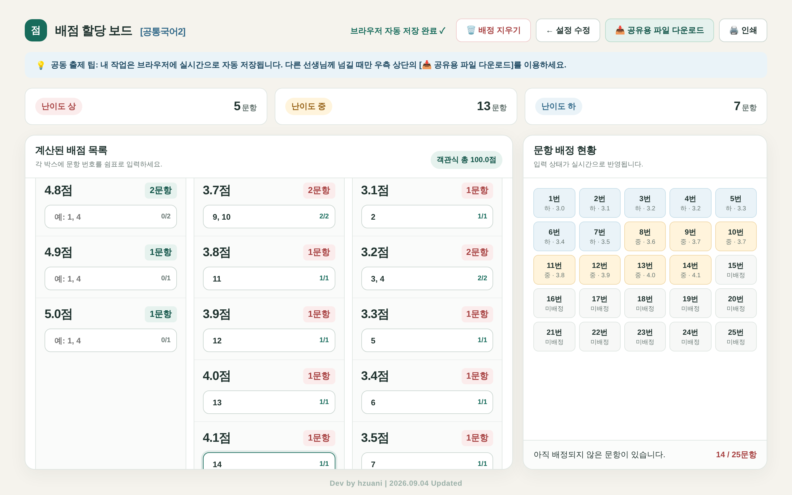

# 시험 문항 배점 도우미

객관식 문항 수와 총점, 난이도 비율을 넣으면 **0.1점 단위 배점표**를 만들고, 문항 번호를 배정해 **인쇄용 배점표**까지 뽑아 주는 웹 도구입니다.
지필평가 공동 출제 때 배점 맞추는 시간을 줄이려고 만들었습니다.

## 쓰는 법

1. `index.html`을 크롬이나 엣지로 엽니다. 설치는 필요 없고 파일 하나로 돌아갑니다.
2. 과목명, **객관식** 총 문항 수, 객관식 총점, 상·중·하 난이도 비율(합 100%)을 입력합니다.
3. **배점표 생성하기**를 누르면 점수별로 필요한 문항 수가 나옵니다.
4. 각 점수 칸에 문항 번호를 쉼표로 적습니다. 오른쪽 현황판에서 중복·누락이 바로 보입니다.
5. 다 채우면 **인쇄**로 A4 배점표를 뽑습니다.

## 계산 방식

- 문항 수를 난이도 비율대로 나눈 뒤, 남는 문항은 소수점이 큰 쪽부터 채웁니다.
- 배점은 낮은 점수부터 높은 점수까지 고르게 펼치고(하 → 중 → 상), **0.1점 단위로 총점에 정확히 맞춥니다.**
- 서논술형은 계산에서 빼고 객관식만 다룹니다.

## 공동 출제할 때

- 작업 내용은 **내 브라우저에 자동 저장**됩니다.
- 다른 선생님께 넘길 때는 **공유용 파일 다운로드**로 `.json` 파일을 받아 전달하고, 받은 쪽은 **공유받은 파일 불러오기**로 엽니다.
- 서버로 아무것도 보내지 않습니다.

## 참고

- 컴퓨터 화면에 맞춰 만들었습니다. 휴대폰에서는 레이아웃이 깨질 수 있습니다.

## 라이선스

[MIT](LICENSE)
