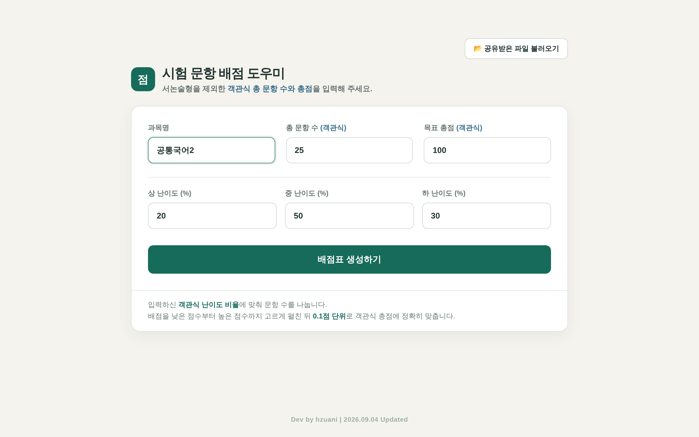

# 📝 시험 문항 배점 도우미

> 객관식 문항 수와 총점, 난이도 비율만 넣으면 0.1점 단위 배점표를 만들고, 문항 번호 배정부터 인쇄까지 하는 웹 도구

**[▶ 바로 써보기](https://hzuani.github.io/exam-scorer/)** · 설치 없음 · 파일 하나(`index.html`)로 동작

---

## 왜 만들었나

지필평가를 공동 출제할 때마다 배점을 맞추는 일이 생각보다 오래 걸렸어요.
난이도 비율에 맞춰 문항 수를 나누고, 점수를 조금씩 다르게 주면서 총점은 딱 100점에 맞추고, 문항 번호까지 겹치지 않게 배정하려면 계산기와 표를 계속 오가야 했고요.
그래서 **설정 → 배점 계산 → 문항 배정 → 인쇄**를 한 화면에서 끝내는 도구를 만들었습니다.

## 주요 기능

| 기능 | 설명 |
|---|---|
| ⚖️ 난이도별 문항 수 | 상·중·하 비율(합 100%)에 맞춰 문항 수를 자동으로 나눔 |
| 🧮 배점 계산 | 낮은 점수부터 높은 점수까지 고르게 펼치고 **0.1점 단위로 총점에 정확히** 맞춤 |
| 🔢 문항 번호 배정 | 점수 칸마다 문항 번호를 쉼표로 입력. 개수가 다 차면 표시가 바뀜 |
| 🚦 실시간 점검 | 오른쪽 현황판에서 **중복 번호·미배정 문항**이 바로 보임 |
| 🖨️ 인쇄 | 번호·난이도·배점을 담은 A4 배점표 |
| 🤝 공동 출제 | 작업 내용을 `.json` 파일로 내려받아 다른 선생님께 넘기고, 받은 쪽은 불러와서 이어 작업 |
| 💾 자동 저장 | 브라우저에 실시간 자동 저장. 다음에 열면 이어서 작업 가능 |

## 쓰는 법

1. **[바로 써보기](https://hzuani.github.io/exam-scorer/)** 를 열거나, `index.html`을 내려받아 브라우저로 엽니다.
2. 과목명, **객관식** 총 문항 수, 객관식 총점, 상·중·하 난이도 비율을 적고 **배점표 생성하기**를 누릅니다.
   - 서논술형은 빼고 객관식만 넣습니다.
3. 점수 칸마다 문항 번호를 적습니다. 오른쪽 현황판이 모두 채워지면 **배정 완료**로 바뀝니다.
4. **인쇄**로 배점표를 뽑거나, **공유용 파일 다운로드**로 다른 선생님께 넘깁니다.

## 개인정보

- 학생 정보는 전혀 다루지 않습니다.
- 입력한 내용은 **내 컴퓨터 브라우저 안에서만** 처리되고, 어떤 서버로도 전송되지 않습니다.

## 참고

- 컴퓨터 화면에 맞춰 만들었습니다. 휴대폰에서는 레이아웃이 깨질 수 있습니다.

## 만든 방법

- HTML · CSS · JavaScript 파일 하나 (프레임워크·외부 라이브러리 없음)
- Claude와 함께 바이브 코딩으로 제작

---

made by [hzuani](https://github.com/hzuani) · 학교 업무 도구를 만드는 국어 교사
